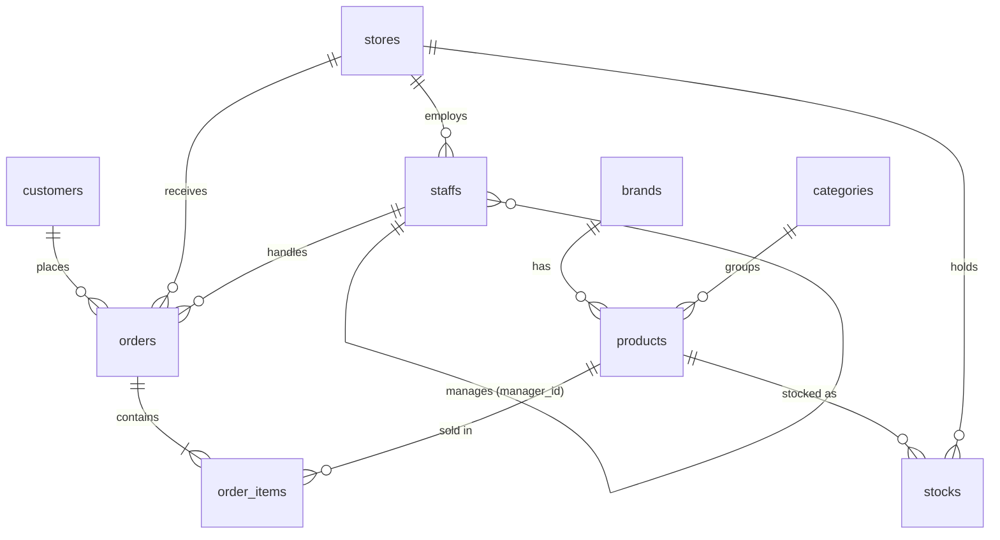

# Bike Store SQL Analysis

End-to-end SQL analysis of a multi-store bike retailer's sales, performance, delivery, and inventory data — from raw relational data to business-ready insights.

>  Python companion project (EDA + statistical testing): 

## Project Overview

This project answers core retail business questions using pure SQL against a 9-table relational database (customers, orders, order_items, products, stores, staffs, stocks, brands, categories).

**Dataset:** Bike Store relational database — 3 stores, 1,445 customers, 321 products, 1,615 orders, 4,722 order line items.

## Business Questions Answered

- **Sales trend** — which products, stores and months drive revenue?
- **Performance** — how do stores, staff and customers rank?
- **Order fulfillment** — what is the late-delivery rate, and who/what is affected?
- **Products** — best and worst sellers, by store and overall
- **Inventory** — what is out of stock, low stock or overstocked at each store?

## Schema



`orders.order_status`: 1 = Pending · 2 = Processing · 3 = Rejected · 4 = Completed

## Tools

MySQL 8.0 · MySQL Workbench · multi-table JOINs, GROUP BY/HAVING, CASE WHEN, subqueries, CTEs

## Repository Structure

```
├── sql/
│   ├── 01_sales_trend.sql
│   ├── 02_performance.sql
│   ├── 03_orders_delivery.sql
│   └── 04_inventory.sql
├── docs/query_explanations.md
└── README.md
```

## Sample Query & Result

**Question:** Which stores have the highest late-delivery rate?

```sql
SELECT 
    s.store_name,
    COUNT(DISTINCT o.order_id) AS total_orders,
    SUM(CASE WHEN o.shipped_date > o.required_date THEN 1 ELSE 0 END) AS late_orders,
    ROUND(100.0 * SUM(CASE WHEN o.shipped_date > o.required_date THEN 1 ELSE 0 END)
          / COUNT(DISTINCT o.order_id), 2) AS late_rate_pct
FROM orders o
JOIN stores s ON o.store_id = s.store_id
WHERE o.order_status = 4 AND o.shipped_date IS NOT NULL
GROUP BY s.store_name
ORDER BY late_rate_pct DESC;
```

| store_name | total_orders | late_orders | late_rate_pct |
|---|---|---|---|
| Santa Cruz Bikes | 284 | 104 | 36.62 |
| Baldwin Bikes | 1019 | 317 | 31.11 |
| Rowlett Bikes | 142 | 37 | 26.06 |

## Key Findings

1. **Revenue is concentrated in one store.** Baldwin Bikes generates **70.6%** of revenue ($4.70M of $6.66M) — about 3.7x Santa Cruz and 6.7x Rowlett. Rowlett has the highest average order value ($4,971 vs. Baldwin's $4,614), but each customer places only one order, so this reflects higher-value orders, not repeat buyers.

2. **About 1 in 3 orders ships late.** The on-time rate is **68.3%** (987 of 1,445 completed orders). Santa Cruz is highest at 36.6%, but the gap between stores is **not statistically significant** (chi-square p ≈ 0.066, tested in the Python project) — the delivery issue looks company-wide rather than store-specific.

3. **Best sellers are out of stock.** Electra Girl's Hawaii 1 has zero stock at Baldwin despite 93 units sold there; Trek Remedy 29 Carbon Frameset (#5 best seller overall, 123 units, ~$200K) has zero stock at Santa Cruz, where it sold 32 units.

4. **Overstock sits in the smaller stores.** Using a rule of *stock ≥ 20 units and no sales in the last 3 months of data (Jan–Mar 2018)*, **$7.13M (35.9%) of inventory value** is flagged. Trek accounts for 66.8% of it. **86% of the flagged value is at Rowlett and Santa Cruz** (88 and 74 SKUs), versus 32 SKUs at Baldwin — the store that sells the most. Largest single item: Trek Domane SLR 9 Disc (2018) at Rowlett, $300K.

5. **25 SKU–store combinations are out of stock:** Santa Cruz 10, Baldwin 10, Rowlett 5.

## Notes & Limitations

- Completed orders only exist from **Jan 2016 to Mar 2018**; 2018 is a partial year, so year-over-year comparisons use months/quarters.
- Date logic uses the **last order date in the data** instead of `NOW()`, since the dataset ends in 2018.
- The overstock thresholds (≥ 20 units, 3-month window) are analyst choices, not business rules. Rowlett sold only 82 units in that window, so part of its flagged stock reflects low store velocity.
- No cost or margin data — analysis is revenue-based.

## Python analysis: 
Gg colab: https://colab.research.google.com/drive/1tGksbvhwlrUVzl371P6YlSJZG_gMIxlA?usp=sharing

